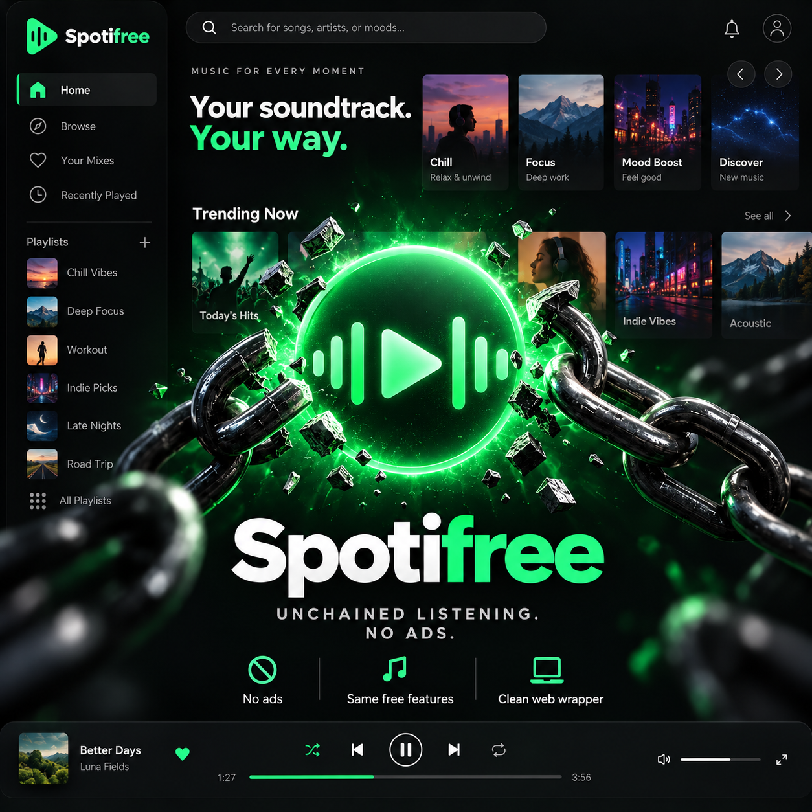

<p align="center">
  
</p>

<p align="center">
  <a href="https://github.com/AKeybladeMaster/Spotifree/releases/latest">
    
  </a>
</p>

<p align="center">
  
  
  
  
  <a href="./LICENSE"></a>
</p>

# Spotifree

Spotifree is a lightweight Android and Windows app for using the official Spotify Web Player, with native search, playback controls, and platform integrations.

## Features

- Opens Spotify's web player in an embedded browser and keeps one local browser profile per installation, so sign-in can persist.
- Provides Spotify search and browser navigation, including back, forward, home, and reload.
- Adds previous, play/pause, and next controls.
- On Android, provides a media notification and a resizable home-screen playback widget.
- On Windows, supports playback keyboard shortcuts and system media keys.
- Restricts in-app navigation to HTTPS.
- Has no multi-profile interface or ad-filter controls. Host filtering is disabled on Android and off by default on Windows; Windows filtering can be enabled through local developer settings.

## Platforms and technologies

| App | Technologies |
| --- | --- |
| Android | Java, Android SDK, Android System WebView |
| Windows desktop | C#, Windows Forms, Microsoft WebView2 |
| Build scripts | PowerShell |

## Download and run

Get the latest APK and Windows release files from [GitHub Releases](https://github.com/AKeybladeMaster/Spotifree/releases/latest).

- **Android:** install `spotifree-android.apk` on Android 8.0 (API 26) or later. Playback and sign-in run in Android System WebView.
- **Windows:** keep `Spotifree-windows.exe` beside the three WebView2 support DLLs from the release, then run the EXE. The Microsoft Edge WebView2 Runtime must also be installed.

Spotifree displays Spotify's own web experience; sign-in, catalog access, and playback depend on Spotify and the account being used.

## Build from source

Build scripts run on Windows PowerShell.

### Android

Requirements: a JDK and Android SDK platform 35 with Build Tools 35.0.0. Set `ANDROID_SDK_ROOT` or `ANDROID_HOME` if the SDK is outside the script's default cache locations.

```powershell
powershell -ExecutionPolicy Bypass -File ./spotifree-android-v2/build.ps1
```

Output: `spotifree-android-v2/dist/spotifree-android.apk`.

### Windows desktop

Requirements: Windows, the .NET Framework C# compiler, and the WebView2 SDK. The script checks `WEBVIEW2_SDK_DIR` and its local caches; if the SDK is not cached, it downloads a pinned package and verifies its checksum.

```powershell
powershell -ExecutionPolicy Bypass -File ./spotifree-desktop-v2/build.ps1
```

Output: `spotifree-desktop-v2/dist/Spotifree-windows.exe` and the required WebView2 support DLLs.

## Windows keyboard shortcuts

| Shortcut | Action |
| --- | --- |
| Ctrl + K | Focus Spotify search |
| Ctrl + H | Go to Spotify home |
| Ctrl + R | Reload |
| Alt + Left / Right | Back / forward |
| Ctrl + Shift + Space | Play / pause |
| Ctrl + Shift + Left / Right | Previous / next track |

The Windows app also responds to system play/pause, previous, and next media keys.

## Project folders

- `spotifree-android-v2/` — Android app and build script.
- `spotifree-desktop-v2/` — Windows desktop app and build script.
- `unchained-spotifree-neon-green.png` — Spotifree project logo.
