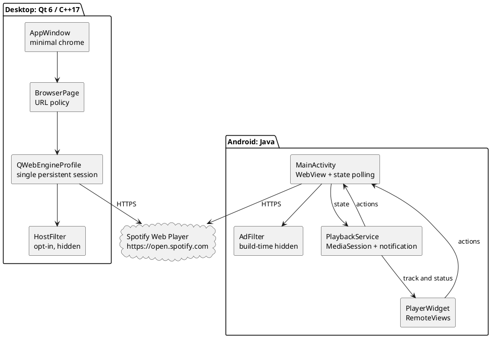

# SPEC-1-Spotifree-v1

## Background

The legacy Spotifree app has an added multi-profile interactive header and an
ad-filtering toggle. The supplied attached Spotify.zip file in the past is a proprietary Windows binary
distribution, not a cross-platform playback backend. The rewrite keeps a small
native window around the supported Spotify Web Player without touching Spotify
binaries, authentication, or encrypted media.

## Requirements

**Must**
- M1. Windows, macOS, Linux desktop source and build/release automation.
- M2. Android Java native source, media notification, widget, debug APK build.
- M3. Exactly one persistent browser profile per app installation.
- M4. No custom multi-profile header, profile dialog, or visible ad-filter switch.
- M5. HTTPS-only main-frame navigation; cookies stored only in per-user app data.
- M6. Search/navigation/media actions without exposing arbitrary JS to remote pages.

**Should**
- S1. Host filtering remains hidden developer configuration, disabled by default.
- S2. Automated builds and unit tests for URL validation and host matching.
- S3. Explicit disclaimer about Widevine, browser compatibility, signing.

**Could**
- C1. Verified release signing, notarization, and distribution store submissions.
- C2. UI automation after device/platform runners and test accounts are available.

**Won't**
- W1. Reverse engineer or clone Spotify's streaming/auth backend, circumvent DRM.
- W2. Redistribute Spotify.exe, Spotify.dll, user files, or bundled CDMs.
- W3. Guarantee DRM playback in unverified embedded browsers.

## Method

Desktop uses a persistent Qt profile with an app-private storage path, one
WebView, no header, and keyboard shortcuts. The optional host interceptor
uses exact/suffix domain matching with a dot boundary. Desktop settings:
`{ "adFilteringEnabled": false }` in the user config path.

Android uses a single WebView and native MediaSession service. No
`addJavascriptInterface` is used: metadata is *read* with JS injected from the
native app into the top-level `open.spotify.com` page and decoded as JSON.
Commands are a closed enum (`next`, `previous`, `play`, `pause`, `toggle`).
Notification/widget controls apply only while the Activity WebView exists.
The service cannot own a standalone background Spotify playback engine.

No application database or account credential table exists. Persistent state is
in embedded browser cookies/storage (Qt per-user profile or Android WebView).
The Android widget shares last-track state with `PlaybackService` in process,
and displays an initial placeholder after restart.

## Implementation

1. Record archive inventory and treat Spotify executables/user data as
   private, non-distributable reference material.
2. Put REA/find-skills and code-quality guides in local `.agents/skills`;
   refresh official upstream skill files on an internet-enabled machine.
3. Implement desktop Qt/C++ modules with strict URL and host policy tests.
4. Implement Android WebView, media session, notification and widget.
5. Use GitHub Actions runner builds for Windows/macOS/Linux/Android.
6. Test authentication/DRM and keyboard/media behavior on real target devices.
7. Provision Android release key, Apple signing/notarization, and CI pinning
   before promoting draft preview artifacts to verified production releases.

## Milestones

- **A. Source rewrite:** C++/Java project skeleton, removal of header and
  profile switching. (Included here.)
- **B. Quality gates:** URL/host tests and CI workflows. (Included, not executed
  in the offline environment.)
- **C. Preview release:** CI emits four artifacts. (Pending execution.)
- **D. Verified release:** account login and DRM playback sign-off on each
  OS; credentials, signing, notarization. (Not yet performed.)

## Gathering Results

- Build success rate per OS; 100% required before publication.
- Unit tests: URL scheme rejection, encoded search, suffix host boundary.
- Manual: launch/login/play/pause/skip/search/back, close/relaunch preserves
  one login, no added header/filter setting in app UI.
- Manual: Android hardware controls, notification/widget after screen lock,
  activity background/termination behavior, and repeated process recreation.
- Check network and crash traces without collecting cookies, account tokens,
  or listening history. Record known DRM failures as unsupported rather than
  attempting protected-media circumvention.

## Need Professional Help in Developing Your Architecture?

Please contact me at [sammuti.com](https://sammuti.com) :)
